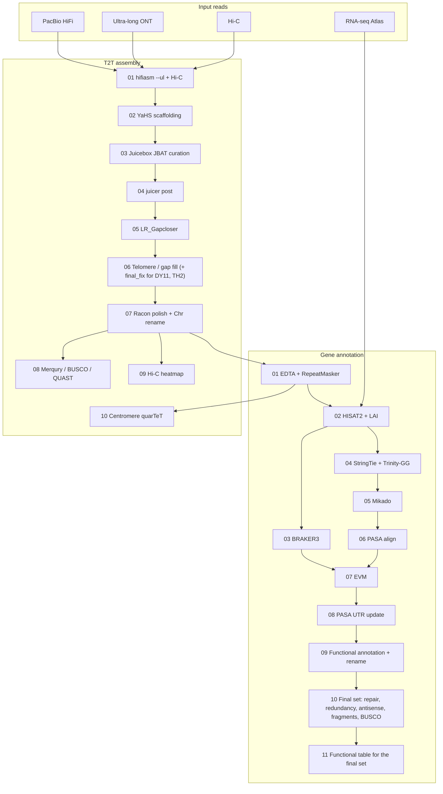

# Soybean T2T Assembly and Annotation Pipeline

**中文说明请见 [README.zh-CN.md](README.zh-CN.md).**

Reproducible telomere-to-telomere (T2T) genome assembly and evidence-based gene annotation for soybean (*Glycine max*). The pipeline was developed for cultivar genomes (KD35, N2L and additional accessions) using PacBio HiFi, ultra-long Oxford Nanopore (ONT) and Hi-C reads, plus short-read RNA-seq for annotation.

This repository contains **scripts, helper code and environment notes**. It does **not** include raw reads, assemblies or annotation GFF/FASTA (too large for GitHub). Place those data in a separate work directory and point `ROOT` at it. Longer methods notes under `docs/` stay on disk and are not part of this repository for now.

---

## Overview



**Publication gene set** is `13_final/` after step 10, not the step-09 high-confidence subset. Three disjoint classes share Chr01–Chr20, confidence ≥ medium and TE overlap ≤ 0.5:

| Class | Extra rule |
|-------|------------|
| `high_confidence` | ZH13 v3 identity ≥ 50%; expression not required |
| `expressed_zh13_below_50` | Expressed, ZH13 v3 identity < 50%; not rewritten from a full ZH13 protein |
| `homolog_unexpressed` | Unexpressed, ZH13 v3 identity < 50%, plus a best soybean-proteome hit at ≥ 50% identity and ≥ 50% coverage both ways |

Step 10 repairs short high-confidence models, removes same-strand duplicates and fragments, keeps an antisense CDS overlap only when both genes have reliable homology, removes unexpressed partial copies of genes that already have a full-length copy, then runs protein BUSCO. Locus IDs are not renumbered. Step 11 writes the gene functional table for that final set. `12_renamed/` keeps the renamed models and the drop list.

---

## Repository layout

```
soybean_assembly_annotation/
├── README.md / README.zh-CN.md
├── LICENSE / CITATION.cff / .gitignore
├── config/config.env.example      # paths and HC filter knobs
├── env/                           # conda environments
├── assembly/                      # 01–10 T2T scripts + Python helpers (KD35, N2L)
│   └── batch2/                    # 01–10 drivers as run for BZ, DY11, TH2, TZX1998, TZX253
├── annotation/                    # EDTA → BRAKER → EVM → polish → final set
└── preprocess/                    # optional HiFi / Hi-C / RNA cleaning
```

Each script has a **config block (配置区)** at the top. Paths such as `/tiandata2/` and `/home/zzh/` are **lab examples only**. You must replace them with your own directories, or `export ROOT=...` / `export ANACONDA=...` (and other variables listed in `config/config.env.example`) before running. Do not commit genomes, reads, or annotation GFF/FASTA to this repository.

---

## Requirements

- Linux server (this pipeline was run with 16–64 threads per step)
- Conda / Mamba (see [env/README.md](env/README.md))
- External tools not always shipped as conda packages: YaHS, juicer_tools, LR_Gapcloser, quarTeT, GeneMark-ETP, ProtHint, InterProScan
- Reference files: Wm82 and ZH13 genomes; Viridiplantae proteins; SwissProt Diamond DB; BUSCO `embryophyta_odb10`; five soybean reference proteomes (ZH13 v2/v3, Wm82 a2/gnm4/gnm6)

GeneMark-ETP is academic-licensed software. Obtain it from the authors before running BRAKER3.

---

## Quick start

```bash
git clone https://github.com/sibs-zz/soybean_assembly_annotation.git
cd soybean_assembly_annotation
cp config/config.env.example config/config.env
# You must edit this file: ROOT, conda envs, YaHS/juicer/EDTA, reference FASTA, etc.
# Scripts still contain example paths under /tiandata2/ and /home/zzh/ — replace them
# or export the variables below so ${VAR:-default} overrides take effect.

export ROOT=/path/to/workdir
export ANACONDA=/path/to/anaconda3/envs
export THREADS=32

# workdir expected layout (minimal)
#   $ROOT/hifi/${sample}_hifi.filt.fastq.gz
#   $ROOT/ont/${cultivar}_ONT_clean.fq.gz
#   $ROOT/hic/${cultivar}_clean_{1,2}.fq.gz
#   $ROOT/rna_clean/${cultivar}_RNA_Atlas_{1,2}.fq.gz
```

Run assembly, then annotation, in numeric order. Do not start 08/09 annotation until 07 assembly (`*_Chr.fa`) exists.

```bash
# Assembly (from the clone; helpers resolve relative to assembly/)
cd assembly
bash 01_run_hifiasm_t2t.sh
bash 02_run_yahs.sh
# ... Juicebox manual review of 03_JBAT_output ...
bash 04_t2t.sh
bash 05_run_gapcloser.sh
bash 06_gap_telo.sh
bash 07_polish_rename.sh
bash 08_fa_qc.sh
bash 09_run_hic_heatmap_cooler.sh
bash 10_run_centro.sh          # after EDTA TE GFF exists

# Annotation
cd ../annotation
bash 01_EDTA.sh
bash 02_LAI.sh
bash 02_run_HISAT2_align.sh
bash 03_run_BRAKER3.sh
SAMPLE=KD35_primary THREADS=16 bash 04_run_transcripts.sh
SAMPLE=KD35_primary THREADS=16 bash 05_run_mikado.sh
SAMPLE=KD35_primary THREADS=16 bash 06_run_pasa_align.sh
SAMPLE=KD35_primary THREADS=16 bash 07_run_evm.sh
SAMPLE=KD35_primary THREADS=16 bash 08_run_pasa_update.sh
SAMPLE=KD35_primary THREADS=16 bash 09_run_polish.sh
bash 10_final_anno.sh
bash 11_final_function.sh
```

The second batch (BZ, DY11, TH2, TZX1998, TZX253) was assembled with `assembly/batch2/` (`01_prep_hifi_hic.sh` first; HiFi and Hi-C named `<cultivar>_hifi.fq.gz` and `<cultivar>_hic_{1,2}.fq.gz`). These drivers share the Python helpers in `assembly/`. DY11 and TH2 also ran `assembly/06_gap_telo_final_fix.sh` after step 06. Annotation 01–09 for that batch used the scripts in `annotation/` with the five cultivars in `SAMPLES` and `ROOT` set to the batch directory.

Single-sample override: `SAMPLE=N2L_primary THREADS=16 bash 09_run_polish.sh`. Steps 10 and 11 use the cultivar prefix, not the `_primary` assembly name: `SAMPLE=KD35 bash 10_final_anno.sh`. Skip the step-10 BUSCO with `RUN_BUSCO_FINAL=0`. Rerun step 11 after any rerun of step 10.

---

## Expected inputs

| Data | Typical files |
|------|----------------|
| HiFi | `hifi/<barcode>_hifi.filt.fastq.gz` (or FASTA) |
| ONT ultra-long | `ont/<cultivar>_ONT_clean.fq.gz` |
| Hi-C | `hic/<cultivar>_clean_1.fq.gz`, `_2.fq.gz` |
| RNA-seq | `rna_clean/<cultivar>_RNA_Atlas_{1,2}.fq.gz` |
| Genome after 07 | `07_polish_rename/<sample>_primary/03_final/<sample>_primary_Chr.fa` |

Optional preprocess helpers: `preprocess/hifi_bam2fastq.sh`, `hic_fastp.sh`, `rna_salt_clean.sh`.

---

## Final annotation (paper gene set)

Step 09 writes ZH13-style locus IDs (`KD35_01G000100.m1`) under `12_renamed/`. That folder is the traceable renamed set, including the drop list. It is not the submitted gene set.

Step 10 (`10_final_anno.sh`, helpers `curate_final_models.py`, `resolve_final_redundancy.py`, `antisense_qc.py`, and `short_fragment_filter.py`) reads `12_renamed` and writes one gene set to `13_final/`:

1. Drop an abnormal ORF again. A CDS whose length is not divisible by 3 removes the whole gene. A transcript with no CDS, no ATG, an internal stop, or no terminal stop is removed. Gene IDs already on the step-09 drop list cannot return. Locus IDs are not renumbered.
2. Keep three disjoint nuclear classes (Chr01–Chr20, confidence at least medium, TE overlap ≤ 0.5):
   - `high_confidence`: ZH13 v3 identity ≥ 50; expression not required
   - `expressed_zh13_below_50`: expression supported and ZH13 v3 identity < 50
   - `homolog_unexpressed`: no expression, ZH13 v3 identity < 50, and at least one soybean reference whose own best DIAMOND hit has identity ≥ 50, query coverage ≥ 50%, subject coverage ≥ 50%, and E-value ≤ 1e-5
3. Revise short high-confidence models in place when a same-locus miniprot alignment recovers at least 80% of the ZH13 protein without a frameshift or in-frame stop. The new CDS must start with ATG, end with a stop, have a length divisible by 3, and contain no internal stop. A model that fails any of those checks is left unchanged. Two new same-strand CDS that overlap by at least 200 bp are both left unchanged. `expressed_zh13_below_50` is not rewritten from a ZH13 protein.
4. On that same `13_final` directory, merge gene IDs that share one CDS and one protein, keep the ID with the UTR transcripts, and drop a same-strand gene when every CDS coordinate set is already a transcript of another gene at the same ZH13 locus. Do not add that gene as an isoform. Restore an extension whose new CDS overlaps another extension, and drop an unexpressed same-strand fragment whose protein is a continuous piece of a longer gene at the same ZH13 locus.
5. Keep an opposite-strand CDS overlap only when both genes have reliable homology. Drop a single-exon antisense model that lacks that support, and drop the remaining antisense pairs that do not fall into the two retained groups. Removed IDs are listed in `*.final.antisense_excluded.tsv`.
6. Align the longest final protein of each gene to ZH13 v3 and Wm82 a6. Drop an unexpressed `high_confidence` gene when no reference protein with identity ≥ 50 is covered by half or more and the same ZH13 gene already has a copy covered ≥ 80% in this genome. Positions of the candidate and of each full-length copy are converted to ZH13 v3 coordinates through the nearest anchor genes on each side (unique top ZH13 hit, identity ≥ 98, coverage ≥ 0.9), so a translocated segment is compared at its ZH13 locus. Keep the candidate when it maps to the chromosome of that ZH13 gene and closer to the ZH13 position than every full-length copy. All candidates and their outcome are listed in `*.final.short_fragment_qc.tsv`.

Use these `13_final` files for the gene count and for submission:

- `*.final.gff3`
- `*.final.transcripts.fa`
- `*.final.cds.fa`
- `*.final.proteins.fa`
- `*.final.genes.list`
- `*.final.gene_class.tsv`
- `*.final.functional_annotation.tsv` (step 11)

Step 11 (`11_final_function.sh`, helper `final_function_table.py`) writes one functional row per `13_final` gene. Removed and merged gene IDs do not appear. A transcript whose protein is identical to a step-09 protein reuses that protein's eggNOG, InterProScan, SwissProt, ZH13 v3 and Wm82 a6 results. A protein changed by extension or merge in step 10 is annotated again with the same tools and databases. TE overlap is recomputed for genes whose coordinates changed. Use this table instead of `12_renamed/*.renamed.gene_functional_annotation.tsv`.

`*.final.corrections.tsv` stores every reviewed short model, including the old and new protein when a model was overwritten. `*.final.id_map.tsv` stores gene or transcript IDs that changed. `*.final.criteria.txt` states the filters. BUSCO protein mode on the longest protein per gene is copied to `*.final.busco.short_summary.txt`.

Repeat annotation stays in `12_renamed/*.renamed.repeat.gff3.gz`. TE IDs are not rewritten as gene loci. Do not report gene numbers from the full `12_renamed` GFF or from `11_publication/`.

### Gene counts in this run

Protein BUSCO is embryophyta_odb10, longest protein per gene, after the step-10 filters.

| Cultivar | Genes | high_confidence | expressed_zh13_below_50 | homolog_unexpressed | BUSCO complete |
|----------|------:|----------------:|------------------------:|--------------------:|----------------|
| KD35 | 55,848 | 53,093 | 932 | 1,823 | C:97.2% |
| N2L | 53,857 | 51,515 | 800 | 1,542 | C:96.9% |
| BZ | 54,837 | 52,160 | 983 | 1,694 | C:96.8% |
| DY11 | 54,189 | 51,599 | 931 | 1,659 | C:97.2% |
| TH2 | 54,751 | 52,153 | 971 | 1,627 | C:97.5% |
| TZX1998 | 54,153 | 51,670 | 927 | 1,556 | C:96.6% |
| TZX253 | 56,173 | 53,589 | 876 | 1,708 | C:96.4% |

Each assembly has 20 chromosomes and no N on those chromosomes. quarTeT TeloExplorer (`-m 50`) calls telomere sequence at all 40 ends. Some terminal tracts have fewer than 50 copies in the outer 20 kb, and some sit tens to about 140 kb inside the tip. The right end of Chr13 in N2L and DY11 stops in the subtelomere; the existing ONT reads do not extend it, and the same reads will not add that telomere on a rerun.

---

## Citation

Please cite the associated soybean genome manuscript (when available) and this repository. Tool papers (hifiasm, YaHS, BRAKER3, PASA, EVM, EDTA, eggNOG, InterProScan, BUSCO, etc.) should be cited in Methods.

---

## License

Code in this repository is released under the [MIT License](LICENSE). Third-party tools keep their own licenses (notably GeneMark-ETP).

---

## Notes for reproducing this work

1. **Manual Hi-C curation** (Juicebox) is an intended step, not a bug. `03_run_jbat_hic.sh` prepares JBAT files; `04_t2t.sh` consumes the reviewed `.assembly`.
2. Several conda environments are used on purpose (Trinity needs salmon 1.x; eggNOG mapper needs Diamond ≥2.2 for `--iterate`). See [env/README.md](env/README.md).
3. Default `09_run_polish.sh` threads are 64; for annotation 04–08 we typically use `THREADS=16`.
4. **Configure paths yourself** before any run: search scripts for `/tiandata2/` and `/home/zzh/`, or `export ROOT` / `ANACONDA` as in `config/config.env.example`. Genome FASTA, BAM, GFF and protein files stay in your work directory, not in git.
