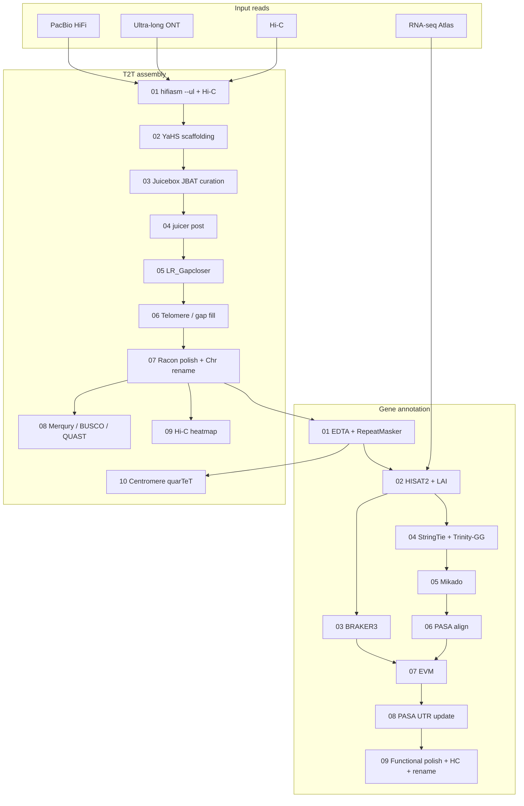

# Soybean T2T Assembly and Annotation Pipeline

**中文说明请见 [README.zh-CN.md](README.zh-CN.md).**

Reproducible telomere-to-telomere (T2T) genome assembly and evidence-based gene annotation for soybean (*Glycine max*). The pipeline was developed for cultivar genomes (KD35, N2L and additional accessions) using PacBio HiFi, ultra-long Oxford Nanopore (ONT) and Hi-C reads, plus short-read RNA-seq for annotation.

This repository contains **scripts, helper code, environment notes and methods documentation**. It does **not** include raw reads, assemblies or annotation GFF/FASTA (too large for GitHub). Place those data in a separate work directory and point `ROOT` at it.

---

## Overview



**Publication gene set (high-confidence, HC)** after step 09:

| Filter | Threshold |
|--------|-----------|
| Chromosomes | Chr01–Chr20 only |
| Confidence | ≥ medium |
| TE overlap | ≤ 0.5 |
| vs ZH13 v3 protein identity | ≥ 50% |

A disjoint **lineage-specific** set (expressed, TE-clean, ZH13 identity < 50%) is written for supplements and cultivar-specific analyses. Full nuclear GFF is retained; those loci are not deleted, only excluded from the HC count.

---

## Repository layout

```
soybean_assembly_annotation/
├── README.md / README.zh-CN.md
├── LICENSE / CITATION.cff / .gitignore
├── config/config.env.example      # paths and HC filter knobs
├── env/                           # conda environments
├── docs/                          # methods notes
├── assembly/                      # 01–10 T2T scripts + Python helpers
├── annotation/                    # EDTA → BRAKER → EVM → polish
└── preprocess/                    # optional HiFi / Hi-C / RNA cleaning
```

Each script has a **config block (配置区)** at the top. Paths such as `/tiandata2/` and `/home/zzh/` are **lab examples only**. You must replace them with your own directories, or `export ROOT=...` / `export ANACONDA=...` (and other variables listed in `config/config.env.example`) before running. Do not commit genomes, reads, or annotation GFF/FASTA to this repository.

---

## Requirements

- Linux server (this pipeline was run with 16–64 threads per step)
- Conda / Mamba (see [env/README.md](env/README.md))
- External tools not always shipped as conda packages: YaHS, juicer_tools, LR_Gapcloser, quarTeT, GeneMark-ETP, ProtHint, InterProScan
- Reference files: Wm82 and ZH13 genomes; Viridiplantae proteins; SwissProt Diamond DB; BUSCO `embryophyta_odb10`; five soybean reference proteomes (ZH13 v2/v3, Wm82 a2/gnm4/gnm6)

GeneMark-ETP is academic-licensed software. Obtain it from the authors before running BRAKER3.

---

## Quick start

```bash
git clone https://github.com/sibs-zz/soybean_assembly_annotation.git
cd soybean_assembly_annotation
cp config/config.env.example config/config.env
# You must edit this file: ROOT, conda envs, YaHS/juicer/EDTA, reference FASTA, etc.
# Scripts still contain example paths under /tiandata2/ and /home/zzh/ — replace them
# or export the variables below so ${VAR:-default} overrides take effect.

export ROOT=/path/to/workdir
export ANACONDA=/path/to/anaconda3/envs
export THREADS=32

# workdir expected layout (minimal)
#   $ROOT/hifi/${sample}_hifi.filt.fastq.gz
#   $ROOT/ont/${cultivar}_ONT_clean.fq.gz
#   $ROOT/hic/${cultivar}_clean_{1,2}.fq.gz
#   $ROOT/rna_clean/${cultivar}_RNA_Atlas_{1,2}.fq.gz
```

Run assembly, then annotation, in numeric order. Do not start 08/09 annotation until 07 assembly (`*_Chr.fa`) exists.

```bash
# Assembly (from the clone; helpers resolve relative to assembly/)
cd assembly
bash 01_run_hifiasm_t2t.sh
bash 02_run_yahs.sh
# ... Juicebox manual review of 03_JBAT_output ...
bash 04_t2t.sh
bash 05_run_gapcloser.sh
bash 06_gap_telo.sh
bash 07_polish_rename.sh
bash 08_fa_qc.sh
bash 09_run_hic_heatmap_cooler.sh
bash 10_run_centro.sh          # after EDTA TE GFF exists

# Annotation
cd ../annotation
bash 01_EDTA.sh
bash 02_LAI.sh
bash 02_run_HISAT2_align.sh
bash 03_run_BRAKER3.sh
SAMPLE=KD35_primary THREADS=16 bash 04_run_transcripts.sh
SAMPLE=KD35_primary THREADS=16 bash 05_run_mikado.sh
SAMPLE=KD35_primary THREADS=16 bash 06_run_pasa_align.sh
SAMPLE=KD35_primary THREADS=16 bash 07_run_evm.sh
SAMPLE=KD35_primary THREADS=16 bash 08_run_pasa_update.sh
SAMPLE=KD35_primary THREADS=16 bash 09_run_polish.sh
```

Single-sample override: `SAMPLE=N2L_primary THREADS=16 bash 09_run_polish.sh`.

Details: [docs/assembly.md](docs/assembly.md), [docs/annotation.md](docs/annotation.md), [docs/outputs.md](docs/outputs.md).

---

## Expected inputs

| Data | Typical files |
|------|----------------|
| HiFi | `hifi/<barcode>_hifi.filt.fastq.gz` (or FASTA) |
| ONT ultra-long | `ont/<cultivar>_ONT_clean.fq.gz` |
| Hi-C | `hic/<cultivar>_clean_1.fq.gz`, `_2.fq.gz` |
| RNA-seq | `rna_clean/<cultivar>_RNA_Atlas_{1,2}.fq.gz` |
| Genome after 07 | `07_polish_rename/<sample>_primary/03_final/<sample>_primary_Chr.fa` |

Optional preprocess helpers: `preprocess/hifi_bam2fastq.sh`, `hic_fastp.sh`, `rna_salt_clean.sh`.

---

## High-confidence annotation (paper gene set)

Step 09 writes ZH13-style locus IDs (`KD35_01G000100.m1`) and three HC deliverables under `12_renamed/`:

- `*.renamed.high_confidence.annotated.gff3`
- `*.renamed.high_confidence.proteins.fa`
- `*.renamed.high_confidence.genes.list`

Use **these files** for the main gene count in a paper. Do not report gene numbers from the full nuclear GFF (~80k loci) or from `11_publication/` if that folder still uses an older filter.

Lineage-specific companion files (`*.renamed.lineage_specific.*`) contain nuclear genes that pass medium confidence, TE ≤ 0.5 and expression, but have ZH13 v3 protein identity < 50% (including no hit).

---

## Citation

Please cite the associated soybean genome manuscript (when available) and this repository. Tool papers (hifiasm, YaHS, BRAKER3, PASA, EVM, EDTA, eggNOG, InterProScan, BUSCO, etc.) should be cited in Methods.

---

## License

Code in this repository is released under the [MIT License](LICENSE). Third-party tools keep their own licenses (notably GeneMark-ETP).

---

## Notes for reproducing this work

1. **Manual Hi-C curation** (Juicebox) is an intended step, not a bug. `03_run_jbat_hic.sh` prepares JBAT files; `04_t2t.sh` consumes the reviewed `.assembly`.
2. Several conda environments are used on purpose (Trinity needs salmon 1.x; eggNOG mapper needs Diamond ≥2.2 for `--iterate`). See [env/README.md](env/README.md).
3. Default `09_run_polish.sh` threads are 64; for annotation 04–08 we typically use `THREADS=16`.
4. **Configure paths yourself** before any run: search scripts for `/tiandata2/` and `/home/zzh/`, or `export ROOT` / `ANACONDA` as in `config/config.env.example`. Genome FASTA, BAM, GFF and protein files stay in your work directory, not in git.
