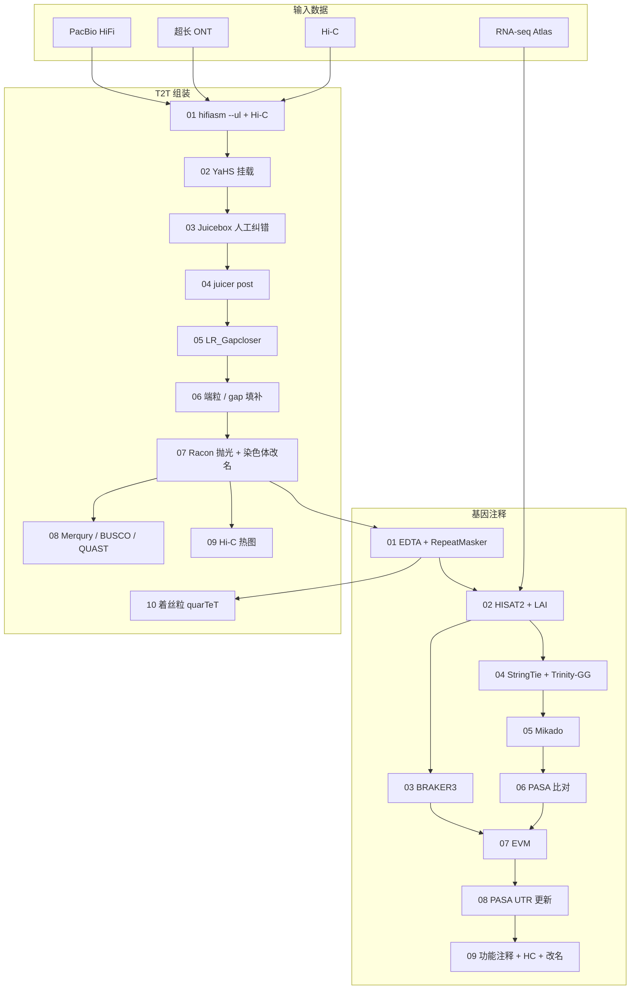

# 大豆 T2T 基因组组装与基因注释流程

**English version: [README.md](README.md).**

本仓库提供大豆（*Glycine max*）端粒到端粒（T2T）组装与证据驱动基因注释的可重复流程，在品种基因组（KD35、N2L 及后续材料）上用 PacBio HiFi、超长 ONT、Hi-C 以及短读 RNA-seq 跑通。

仓库只包含**脚本、辅助代码、环境说明和流程文档**，不含原始测序、组装序列或注释 GFF/FASTA。数据放在独立工作目录，用 `ROOT` 指向即可。

---

## 流程概览



**发表用高置信（HC）基因集**（09 步）：

| 过滤 | 阈值 |
|------|------|
| 染色体 | 仅 Chr01–Chr20 |
| 置信度 | ≥ medium |
| TE 重叠比例 | ≤ 0.5 |
| 相对 ZH13 v3 蛋白 identity | ≥ 50% |

另输出互斥的**品种特异集**（有表达、TE 干净、ZH13 identity < 50%），供补充材料和差异分析。全量核染色体 GFF 仍保留这些位点，只是不计入 HC 基因数。

---

## 目录结构

```
soybean_assembly_annotation/
├── README.md / README.zh-CN.md
├── LICENSE / CITATION.cff / .gitignore
├── config/config.env.example      # 路径与 HC 过滤参数
├── env/                           # conda 环境
├── docs/                          # 方法说明
├── assembly/                      # 组装 01–10
├── annotation/                    # EDTA → BRAKER → EVM → polish → 最终注释
└── preprocess/                    # 可选：HiFi / Hi-C / RNA 清洗
```

每个脚本顶部有**配置区**。其中的 `/tiandata2/`、`/home/zzh/` **只是示例路径，必须改成你自己的目录**，或先 `export ROOT=...`、`export ANACONDA=...`（其余变量见 `config/config.env.example`）。基因组、reads、注释 GFF/FASTA 不要提交进本仓库。

---

## 依赖

- Linux 服务器（各步常用 16–64 线程）
- Conda / Mamba（见 [env/README.md](env/README.md)）
- 部分工具不在 conda 里：YaHS、juicer_tools、LR_Gapcloser、quarTeT、GeneMark-ETP、ProtHint、InterProScan
- 参考：Wm82 / ZH13 基因组、Viridiplantae 蛋白库、SwissProt Diamond 库、BUSCO `embryophyta_odb10`、五套大豆参考蛋白（ZH13 v2/v3，Wm82 a2/gnm4/gnm6）

GeneMark-ETP 需学术许可，运行 BRAKER3 前请自行申请。

---

## 快速开始

```bash
git clone https://github.com/sibs-zz/soybean_assembly_annotation.git
cd soybean_assembly_annotation
cp config/config.env.example config/config.env
# 必须自己改：ROOT、conda、YaHS/juicer/EDTA、参考基因组等
# 脚本里仍有 /tiandata2/、/home/zzh/ 示例路径，请替换，或 export 下列变量覆盖 ${VAR:-default}

export ROOT=/path/to/workdir
export ANACONDA=/path/to/anaconda3/envs
export THREADS=32
```

工作目录最低需要：

```
$ROOT/hifi/          HiFi FASTQ/FASTA
$ROOT/ont/           清洗后的超长 ONT
$ROOT/hic/           清洗后的 Hi-C 双端
$ROOT/rna_clean/     Atlas RNA-seq 双端
```

按编号顺序跑：先组装 01–07 得到 `*_Chr.fa`，再注释。组装 10 着丝粒需要 EDTA 的 TE GFF，应在注释 01 之后。

注释 09 的单样本写法是 `SAMPLE=N2L_primary THREADS=16 bash 09_run_polish.sh`。10 用品种前缀：`SAMPLE=KD35 bash 10_final_anno.sh`。不跑 BUSCO 时加 `RUN_BUSCO_FINAL=0`。

分步说明：[docs/assembly.md](docs/assembly.md)、[docs/annotation.md](docs/annotation.md)、[docs/outputs.md](docs/outputs.md)。

---

## 论文主注释用哪几个文件

09 步把基因改成 ZH13 风格 ID（如 `KD35_01G000100.m1`），结果在 `12_renamed/`。这一层保留改名后的全量注释和删除清单，用来追溯，不作为投稿基因集。

10 步（`10_final_anno.sh`，辅助脚本 `curate_final_models.py`）读取 `12_renamed`，在 `13_final/` 写成一套注释：

1. 再查一遍 ORF。CDS 长度不能被 3 整除就删除整个基因；没有 CDS、没有 ATG、有内部终止或没有终止密码子就删除该转录本。09 步已经删除的基因不会回来。位点编号不重排。
2. 保留三类互不重叠的核基因（Chr01–Chr20，置信度至少 medium，转座元件重叠不超过 0.5）：
   - `high_confidence`：相对 ZH13 v3 的相似度 ≥ 50，不要求表达
   - `expressed_zh13_below_50`：有表达，相对 ZH13 v3 的相似度 < 50
   - `homolog_unexpressed`：没有表达，相对 ZH13 v3 的相似度 < 50，并且五套大豆参考蛋白里至少一套的最高 bitscore 命中同时满足相似度 ≥ 50、查询覆盖 ≥ 50%、参考覆盖 ≥ 50%、E-value ≤ 1e-5
3. 只修补 high-confidence 短模型。同位点 miniprot 能恢复至少 80% 的 ZH13 蛋白、没有移码和框内终止时，才提出新 CDS。新 CDS 必须有 ATG、有终止密码子、长度能被 3 整除、没有内部终止。任一条件不满足就保留原模型。`expressed_zh13_below_50` 不用 ZH13 全长蛋白改写。

**对外报基因数、投注释**用 `13_final/`：

- `*.final.gff3`
- `*.final.transcripts.fa`
- `*.final.cds.fa`
- `*.final.proteins.fa`
- `*.final.genes.list`
- `*.final.gene_class.tsv`

`*.final.corrections.tsv` 记录每个被审查的短模型；改过的行同时保存旧蛋白和新蛋白。`*.final.id_map.tsv` 只记录发生替换的基因号或转录本号。筛选规则在 `*.final.criteria.txt`。每个基因取最长蛋白做的 BUSCO 摘要在 `*.final.busco.short_summary.txt`。

重复序列仍在 `12_renamed/*.renamed.repeat.gff3.gz`。TE ID 不改成基因号。不要用 `12_renamed` 的全量 GFF 或 `11_publication/` 报基因数。

---

## 引用

请引用后续发表的大豆基因组论文（如有）以及本仓库。Methods 中请同时引用 hifiasm、YaHS、BRAKER3、PASA、EVM、EDTA、eggNOG、InterProScan、BUSCO 等工具原文。

---

## 许可

本仓库代码为 [MIT License](LICENSE)。第三方软件仍按其原许可使用（尤其是 GeneMark-ETP）。

---

## 复现时注意

1. Juicebox **人工纠错**是流程的一部分：03 生成 JBAT，04 读取 review 后的 `.assembly`。
2. 多个 conda 环境是有意拆开的（Trinity 需要 salmon 1.x；eggNOG 需要 Diamond ≥2.2 的 `--iterate`）。见 [env/README.md](env/README.md)。
3. `09_run_polish.sh` 默认 64 线程；注释 04–08 建议 `THREADS=16`。
4. **跑之前请自己配路径**：在脚本里搜索 `/tiandata2/`、`/home/zzh/` 并替换，或按 `config/config.env.example` `export ROOT` / `ANACONDA`。基因组和注释结果放在工作目录，不要放进 git。
